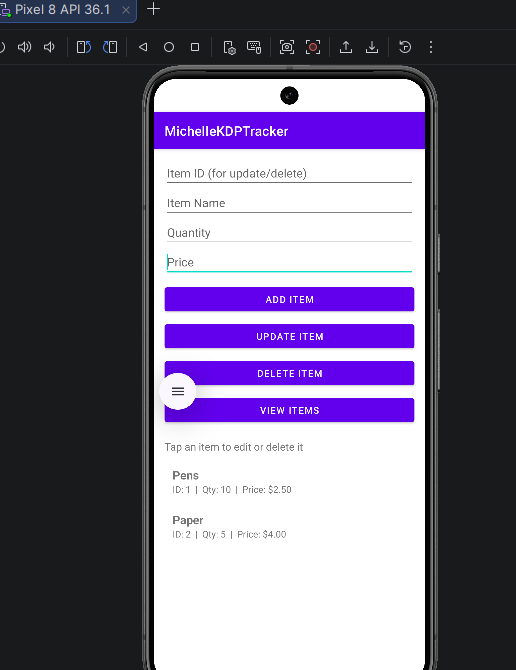
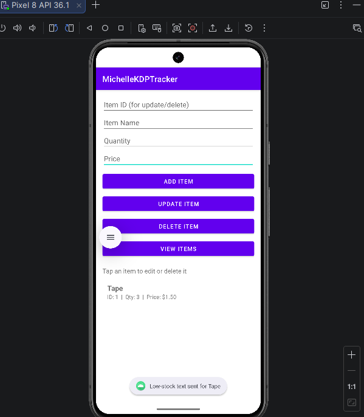

# Enhancement One: Software Design and Engineering

[Back to Home](./)

## Artifact

**MichelleKDPTracker** is an Android inventory tracker app I built in CS-360 Mobile Architecture and Programming in spring 2026. It is written in Java, uses XML for its screens, and stores data in a SQLite database. Users can create an account, log in, and add, update, delete, and view inventory items that each have a name, quantity, and price.

## Why I Included This Artifact

I picked this app because it is a complete project with a login screen, an inventory screen, and a database, so it gives me room to show improvements in all three capstone categories. In my code review, I found real problems a user would notice. The app crashed if someone typed a number that was too large or not valid, the inventory showed up as one block of text, users had to type an item ID to change or delete anything, and the low-stock text alert was never actually sent. The code also had no file headers, a leftover button name called buttonSayHello, and a "magic number" for the SMS permission.

## What I Changed

- **File headers and clear names.** Every file now has a header with my name, the date, the version, and the purpose of the file. I renamed buttonSayHello to buttonLogin so the code is easier to read.
- **Input validation.** I added two helper methods, parseQuantity and parsePrice, that use try/catch to check the user's input, block negative numbers, and show an error message instead of letting the app crash. The update and delete methods also check the item ID the same way.
- **A tappable list instead of a block of text.** I replaced the text display with a RecyclerView. I created an InventoryItem class to hold one item, an item_inventory layout for each row, and an InventoryAdapter class that connects the list of items to the screen. When the user taps a row, the item's ID, name, quantity, and price fill into the boxes automatically, so they no longer have to type the ID.
- **Working low-stock alerts.** A checkLowStock method runs after an item is added or updated and sends a text alert when the quantity is 5 or less, but only if the user allowed SMS permission. If permission was not given, it shows a message on screen instead. I replaced the magic number with named constants like SMS_PERMISSION_REQUEST_CODE and LOW_STOCK_LIMIT.

## How the Pieces Work Together

Based on my instructor's feedback, here is how the list, the adapter, and the database connect. When the user adds, updates, or deletes an item, the change is saved to the SQLite database first. Then the app reads the items back from the database, turns each row into an InventoryItem object, and puts them in a list. That list is handed to the InventoryAdapter, which tells the RecyclerView how many rows to show and fills in each row's name, ID, quantity, and price. When a row is tapped, the adapter sends that item back to the inventory screen so its details fill into the boxes.

## Course Outcomes

This enhancement shows Outcome 4, because I used well-known Android techniques like a RecyclerView, an adapter, and helper methods to make the app more useful and reliable. It also shows progress on Outcome 5, because checking user input before it reaches the database keeps bad data out and prevents crashes, and on Outcome 2, because the file headers, comments, and clearer names make the code easier for other developers to understand.

## What I Learned

I learned how a RecyclerView and an adapter work together to turn a list of data into rows on the screen, and why it helps to keep each piece of code in its own class. I also learned how important defensive programming is. Before, I only checked if a box was empty, but input can be wrong in other ways and needs to be checked before it is used. My biggest challenge was the Android emulator, which kept showing the old version of my app. I had to use the terminal to check the connection, remove the old app, and create a new virtual device. It taught me to troubleshoot step by step instead of giving up.

## Still to Come

Before my final ePortfolio, I plan to add unit tests based on my instructor's feedback, including input validation, invalid item IDs, very large quantities, negative prices, quantities just above and below the low-stock limit, and what happens when SMS permission is denied. I also plan to rename the remaining screen IDs and fix the inventory list so it scrolls all the way down.
